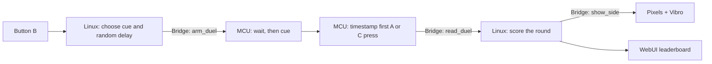

# QC UNO Q Workshop 105: Reaction Duel

As part of this workshop, attendees will build a two-player reflex game with the Arduino UNO Q and Modulinos, and learn why time-critical work belongs on the microcontroller.

The game is intentionally small:

- Player 1 rests a finger on Button A and Player 2 on Button C. Button B starts a round.
- After a random wait, the board gives a cue: a Vibro buzz, all Pixels flashing white, or both. The first player to press wins the round.
- Pressing before the cue is a false start, and the point goes to the other player. The first to three points wins the match.
- The MCU runs the wait, gives the cue, and timestamps both buttons on its own clock. The Linux MPU only arms the round and reads the result.
- A WebUI dashboard on phones shows the score, each round, and a fastest-reaction leaderboard.

> [!IMPORTANT]
> To make the most of the workshop, please complete all pre-requisite instructions before arriving.
>
> Downloading code or required software during the session will cause delays and may prevent you from keeping up with the build.

## Session Pre-requisites

1. Install [Arduino App Lab](https://www.arduino.cc/en/software/#app-lab-section).
2. Clone this repository using `git clone https://github.com/aaishikasb/uno-q-workshops.git` in your terminal.

[`101: Haptic Dial`](../101-haptic-dial/) introduces the MCU, MPU, and Bridge split, but it is not required.

## Hardware Setup (Provided On-site)

### Required Hardware

- Arduino UNO Q
- Modulino Buttons
- Modulino Pixels
- Modulino Vibro
- 3 Qwiic cables
- USB-C cable
- A phone or laptop on the same Wi-Fi network as the board (for the leaderboard)

### Wiring

Chain the Modulinos with Qwiic:

```text
UNO Q Qwiic -> Modulino Buttons -> Modulino Pixels -> Modulino Vibro
```

The order is not important for I2C, but using the same order makes debugging easier.

Lay the board flat between the two players with Button A on Player 1's side. Player 1 owns the left half of the Pixels and Player 2 the right half. If the halves are reversed on your chain, set `PLAYER_ONE_ON_PIXEL_ZERO` to `false` in `sketch.ino`. Place the Vibro where both players can feel or hear it, and release every button before starting the app.

## App Lab Setup

1. Open Arduino App Lab.
2. Select your UNO Q board.
3. If the `Updates` modal appears, **DO NOT** update the board firmware during the workshop.
4. Open **My Apps**.
5. Import `workshop-app.zip` from this directory.
6. Open the imported `UNO Q Reaction Duel` app.
7. Confirm these files are present:
   - `app.yaml`
   - `assets/index.html`
   - `python/main.py`
   - `python/button.py`
   - `python/duel_game.py`
   - `sketch/sketch.ino`
   - `sketch/sketch.yaml`
8. Confirm the app lists the **WebUI** brick.
9. Click `Run` in the top-right corner.
10. Open the dashboard at `http://<board-ip>:7000` on a phone or laptop on the same network. App Lab shows the board's address. Check the port against your App Lab version.

App Lab compiles and flashes the MCU sketch, then starts the Python runtime on the UNO Q Linux side. All eight Pixels turn blue and the Vibro pulses once during startup; this is not a cue.

## Play A Match

1. Both players rest a finger on their button without pressing.
2. Someone presses and releases Button B.
3. One amber Pixel means the round is armed. **Do not press yet.** The cue arrives after a random 3–5 seconds, never sooner than 3 seconds after B is pressed.
4. Press as soon as you notice the cue. The output names the cue type before each round.
5. The winner's half of the Pixels lights in their color. Release your button to continue.

| Color or pattern | Meaning |
| --- | --- |
| Green Pixels from the left | Player 1's points between rounds |
| Blue Pixels from the right | Player 2's points between rounds |
| One amber Pixel | Armed and waiting; do not press |
| Eight white Pixels | Light cue: press now |
| A short Vibro buzz | Buzz cue: press now (the amber Pixel stays unchanged) |
| One half green or blue | That player won the round |
| One half red | That player made a false start |
| Eight amber Pixels | Nobody pressed within two seconds |
| Winner's half lit plus a long buzz | Match over; press B for a new match |

Button B never counts as a press in the duel, and A or C never start a round. A press of B that began before the next prompt appeared is ignored, so a held or late tap cannot start the next round early.

## How The Demo Works



### Why the MCU times the race

Each Bridge call between Linux and the MCU takes several milliseconds, and the time varies with system load. Two players are often only 10–30 ms apart. If Python polled the buttons and timed the race, the Bridge delay could easily be bigger than the gap between the players, and the wrong player could win. The MCU samples both buttons every 5 ms on one clock and compares the moment each press **began**. Python only learns the result once the round is over.

### MCU Responsibilities

- Sample all three buttons every 5 ms and debounce each one for 20 ms.
- Run the random wait, give the cue, and timestamp each press at the start of its stable transition.
- Decide the winner by the earlier press, even when both settle in the same sample.
- Detect false starts, including a press still debouncing at the moment of the cue.
- Report a timeout if nobody presses within two seconds.
- Buffer button edges and send them to Linux as one `poll_input()` JSON packet: `[now, pressed_mask, overflow, [[button, down, at], ...]]`.

### Linux MPU Responsibilities

- Start rounds from Button B, choose the cue and delay, and arm the MCU.
- Poll `read_duel()` until the round finishes, then read the reaction time.
- Apply the match rules in `duel_game.py`: first to three, false-start penalty, timeout.
- Keep a top-ten fastest-reaction leaderboard and save it to `data/leaderboard.json`.
- Serve the dashboard state to the WebUI page at `/api/state`.

### Result codes

| `read_duel()` | Meaning |
| --- | --- |
| `-2` | Round still running |
| `0` | Timeout, no point |
| `1` / `2` | Player 1 / Player 2 wins |
| `11` / `12` | Player 1 / Player 2 false start; the other player wins |

Wins under 80 ms still score a point but are left off the leaderboard. They're almost certainly a guess, not a reaction.

## Suggested Experiments

- Compare buzz, light, and both cues. Which one do you react to fastest?
- Change `MIN_DELAY_MS` and `MAX_DELAY_MS` in `main.py`. How do short, predictable delays affect false starts?
- Change `WINS_NEEDED` in `duel_game.py` for a longer match.
- Add a three-player mode where Button B also plays. Which files have to change, and why does the sketch need to change too?
- Move the timing into Python by polling the buttons every loop, and compare the results. Why are they less fair?

## Troubleshooting

### Pressing B does nothing

Release every button, wait for the score prompt, then press and release B. A press that began before the prompt, or a hold longer than 1.5 seconds, is ignored. The output says if the MCU refused to arm because a button was still held.

### The wrong player gets the point

Check that Player 1 is on Button A. If the Pixel halves are on the wrong sides, set `PLAYER_ONE_ON_PIXEL_ZERO` to `false` in `sketch.ino` and run again.

### The dashboard does not load

Check that the phone and board are on the same network, and that the network allows devices to reach each other. University networks such as eduroam often block this, so use a travel router. Check that the app lists the WebUI brick and that the port matches your App Lab version. The game still works without the dashboard.

### The output reports a button buffer overflow

The round is cancelled. Release all buttons and press B to start again. Repeated overflows or malformed packets mean you should restart the app and check the Qwiic chain.

### The leaderboard survives restarts

That is intentional. Delete `data/leaderboard.json` in the app folder to clear it.

## Files

- `workshop-app/`: App Lab project source
- `workshop-app/app.yaml`: app name and the WebUI brick
- `workshop-app/assets/index.html`: phone dashboard, plain JavaScript with no external libraries
- `workshop-app/python/main.py`: round and match flow, WebUI state
- `workshop-app/python/button.py`: MCU event parsing for three buttons
- `workshop-app/python/duel_game.py`: match rules and leaderboard persistence
- `workshop-app/sketch/sketch.ino`: button sampling, cue timing, and Pixels/Vibro feedback
- `workshop-app.zip`: importable App Lab project
- `test_reaction_duel.py`: regression check of the rules, leaderboard, and simulated rounds, matches, and restarts
- `test_sketch.py`: host simulation of the actual sketch, including tie-breaks, false starts, timeouts, and clock rollover

Run from the repository root:

```sh
python3 -B 105-reaction-duel/test_reaction_duel.py
```

The command also runs the host sketch simulation when a C++17 compiler (`c++`) is available; otherwise it reports that part as skipped.

App Lab import, board compilation, the WebUI brick API (`WebUI`, `expose_api`, the default port), I2C communication, and physical cue timing still need an on-device check. The host simulation does not compile against the Arduino board libraries.

## Sources

- Arduino UNO Q hardware docs: https://docs.arduino.cc/hardware/uno-q
- Arduino App Lab docs: https://docs.arduino.cc/software/app-lab/
- Arduino Bridge guide: https://docs.arduino.cc/software/app-lab/bridge/get-started-with-bridge
- Arduino Bridge API: https://docs.arduino.cc/software/app-lab/bridge/bridge-api
- Arduino RouterBridge library: https://github.com/arduino-libraries/Arduino_RouterBridge
- Arduino App structure: https://docs.arduino.cc/software/app-lab/apps/about-apps
- Arduino Modulino library: https://docs.arduino.cc/libraries/arduino_modulino
- Pinned Modulino 0.8.0 API source: https://github.com/arduino-libraries/Arduino_Modulino/blob/0.8.0/src/Modulino.h
