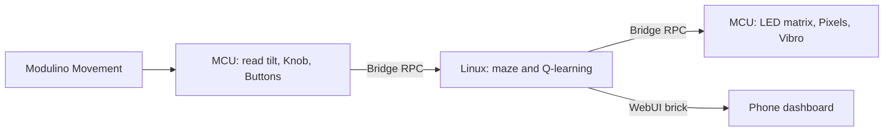

# QC UNO Q Workshop 301: AI Maze

As part of this workshop, attendees will race a reinforcement-learning agent through a sliding tilt maze on the Arduino UNO Q's built-in LED matrix.

The app interacts in the following manner:

- A student tilts the board to roll a ball through a maze shown on the 8×13 LED matrix. Each tilt rolls the ball until it hits a wall, like the classic handheld toys.
- A Q-learning agent then learns the same maze live on the Linux MPU, with no ML framework and no internet.
- The Knob sets the training speed and pressing it moves the exit, the Buttons control the round, the Pixels show the agent's success rate, and the Vibro buzzes when the agent first escapes and when it learns the best route.
- A WebUI dashboard on phones shows a live 3D model of the maze that tilts with the Movement Modulino, with arrows on the floor for what the agent has learned, a caption saying what is happening, a moves-per-attempt chart, and a Human vs AI scoreboard.
- Every board starts on the same Maze #1 and trains it identically, so a room can follow the facilitator's screen step by step.

> [!NOTE]
> This `301` module is a reinforcement-learning capstone, not an Edge Vision module. It uses no webcam.

> [!IMPORTANT]
> Complete the software prerequisites before arriving. Downloading App Lab or board software during the session will cause delays and may prevent you from keeping up with the build.

## Prerequisites

1. Install [Arduino App Lab](https://www.arduino.cc/en/software/#app-lab-section).
2. Clone this repository using `git clone https://github.com/aaishikasb/uno-q-workshops.git` in your terminal.
3. Optional: complete [`105: Reaction Duel`](../105-reaction-duel/) (Buttons and the WebUI dashboard) and [`201: Gesture Dial`](../201-gesture-dial/) (learning from examples). This module contrasts with 201: here the model learns by trial and error instead.

## Hardware Setup

### Required Hardware (Provided On-site)

- Arduino UNO Q
- Modulino Movement
- Modulino Knob
- Modulino Buttons
- Modulino Pixels
- Modulino Vibro
- 5 Qwiic cables
- USB-C cable
- A phone or laptop on the same Wi-Fi network as the board (for the dashboard)

### Wiring

Chain the Modulinos with Qwiic:

```text
UNO Q Qwiic -> Modulino Movement -> Modulino Knob -> Modulino Buttons -> Modulino Pixels -> Modulino Vibro
```

The order is not important for I2C, but using the same order makes debugging easier.

Lay the Movement Modulino flat and fix it to the board (tape or a standoff works) so tilting the board tilts the sensor. The maze is drawn on the UNO Q's built-in LED matrix, so keep the board face up.

## App Lab Setup

1. Open Arduino App Lab.
2. Select your UNO Q board.
3. If the `Updates` modal appears, **DO NOT** update the board firmware during the workshop.
4. Open **My Apps**.
5. Import `workshop-app.zip` from this directory.
6. Open the imported `UNO Q AI Maze` app.
7. Confirm these files are present:
   - `app.yaml`
   - `assets/index.html`
   - `python/main.py`
   - `python/maze_model.py`
   - `sketch/sketch.ino`
   - `sketch/sketch.yaml`
8. Confirm the **WebUI** brick is listed for the app (it is declared in `app.yaml`).
9. Click `Run` in the top-right corner.
10. Open the dashboard on your phone at `http://<board-ip>:7000`. App Lab shows the link when the app starts; use that if it differs.

App Lab compiles and flashes the MCU sketch, then starts the Python runtime on the UNO Q Linux side. The Pixels turn blue and the Vibro pulses once during startup. No additional Python packages or model downloads are required.

## Play The Maze

### Human round

The ball is the solid dot, walls are solid, and the exit blinks slowly. Fast-blinking cells are traps (off by default).

1. Tilt the board in one direction. The ball rolls until it hits a wall or the edge. It starts slowly and speeds up a little each cell, like a ball under gravity, so you can watch where it goes.
2. Tilt another way for the next move. You don't need to level the board in between. Each roll is one move. You can tilt for the next move while the ball is still rolling; it starts when the ball stops.
3. Roll the ball over the exit to escape. The Vibro gives a long buzz and the output prints your moves and time.
4. Press **Button B** to start the AI round. It waits for you, so a whole room can start it together.

Rolling over a trap sends you back to the start. Press **Button B** during the human round to skip it.

### AI round

When you press Button B, the agent starts learning the same maze from scratch. It is never shown the map. All it gets is points: −1 for every move and +10 for the exit.

| Control | Action |
| --- | --- |
| Knob turn | Training speed 0–100. Up to 60, every move is shown, from 0.5 s down to 0.05 s per move (default 45, about 0.2 s). Above 60 it fast-forwards, up to 50 attempts per tick |
| Knob press | **Move the exit.** The agent keeps what it learned, so its old route now leads to the wrong place and it has to learn again |
| Button A | New random maze (any time) |
| Button B | Pause or resume training |
| Button C | Race: the agent plays its best route, then the scores are compared |

The speed only changes how fast you watch. It never changes what the agent learns, so every board on Maze #1 learns in the same number of attempts as the facilitator's.

What to watch on the dashboard:

1. **Exploring.** The ball wanders and a trail follows it. Most attempts give up after 60 moves, marked × at the top of the chart.
2. **First escape** (attempt 3 on Maze #1, short buzz). A yellow arrow appears next to the exit: the agent now knows the last move.
3. **The ripple.** Each escape spreads the arrows one cell further back toward the start, and the dots on the chart drop.
4. **Learned** (attempt 15 on Maze #1, buzz). The dots sit on the dashed "best possible" line. It still tries a random move now and then (`EPSILON`), so some dots stay above the line.
5. **Twist.** Press the knob. The arrows still point to the old exit and attempts fail again, then the agent unlearns them and finds the new exit (about 40 to 55 s on Maze #1).

Gray dots on the floor mark cells the agent has visited but does not yet know a way out from. Brighter arrows mean it is surer.

| Color or pattern | Meaning |
| --- | --- |
| Blue Pixels | Human round |
| Green bar | Training: lit Pixels show the success rate over the last 20 attempts |
| Amber bar | Paused, or a race has finished |
| White Pixels | Race: the agent is playing its best route |
| Short buzz during training | The agent reached the exit for the first time |
| Medium buzz | The agent's route became the best possible, or it finished a race |
| Longer buzz after a knob press | The exit moved |

### Final race

Press **Button C**. The agent plays its best-known route on the matrix, and the caption, output, and dashboard show **your moves vs AI moves vs best possible**. If the agent has not learned a route yet, resume training with Button B and try again. After the race, press the knob to move the exit, or Button A for a new maze.

## How It Works



```text
 MCU (sketch.ino)                         Linux MPU (main.py, maze_model.py)
 read_tilt / read_knob / read_buttons --> mode: human -> training <-> paused -> demo
 set_row / set_goal / set_trap        <-- draw maze
 set_ball                             <-- ball position (human roll or agent move)
 show / pulse                         <-- success bar, buzzes
                                          /api/state --> phone dashboard (every 250 ms)
                                          /api/tilt  --> live 3D board (every 30 ms)
```

### MCU Responsibilities

- Sample the Movement every 5 ms and the Knob and Buttons every 20 ms in `loop()`, and cache the readings. The `read_*` Bridge handlers only return the cache and never touch I2C, the same pattern as the board's `modulino-check` app.
- Keep the Knob's 0–100 position on the MCU from how far it turned between reads, and never write to the Knob. `knob.set()` can invert the value on some Knob firmware, and `knob.get()` returns 0 when a read fails, so a read of 0 right after a big change is skipped.
- Return the raw accelerometer X and Y in milli-g, packed into one int so both come from the same sample.
- Print `AI Maze: <module> found` or `MISSING` for each Modulino at startup. View it with `arduino-app-cli monitor` on the board.
- Store the maze walls, exit, traps, and ball, and redraw the LED matrix every 50 ms with the exit and traps blinking at different rates. The matrix uses 3-bit grayscale, so lit cells are drawn at 7.
- Drive the Pixels and Vibro.

### Linux MPU Responsibilities

- Start on the shared Maze #1 (`DEMO_MAZE_SEED`), then generate a random solvable maze on Button A, and work out the best possible number of moves with a breadth-first search.
- Poll the tilt every 10 ms (100 Hz), five times faster than the buttons, knob, and training, which run every 50 ms.
- Turn the tilt into a direction: it counts beyond `TILT_G` (0.35 g) and keeps counting down to `LEVEL_G` (0.15 g) while it still points the same way, so a shaky hand does not flicker.
- Run the human round: a roll whenever the tilted direction has room, a ball that rolls one cell at a time with gentle acceleration, move count, and timer.
- Run Q-learning at the speed set on the Knob, with the agent's random numbers seeded the same way on every board.
- Move the exit when the Knob is pressed (`move_goal`), keeping the learned table. Because training is deterministic, it replays ahead on a copy of the agent and picks a new exit it will re-learn in about 25 to 70 s.
- Play the greedy route for the demo and compare it with the human score.
- Serve `/api/state` and the fast `/api/tilt` to the dashboard through the WebUI brick.

### The 3D board

The dashboard draws the maze as flat-shaded boxes on a canvas with plain JavaScript and no 3D library. Each frame it rotates the board by the live tilt angles (`asin` of the reading in g), projects every face onto the screen, and draws them far to near. The arrows, gray dots, and trail are flat shapes drawn on the floor before the walls. The page eases toward each new reading, so the board and ball move smoothly between 30 ms updates.

## The Model

The agent uses **tabular Q-learning**, written with the Python standard library in `maze_model.py`.

- **State:** the ball's cell, at most 8 × 13 = 104.
- **Actions:** the four tilts.
- **Brain:** a 104 × 4 table of numbers. `q[cell][action]` is how much total reward the agent expects if it tilts that way from that cell.

Each move updates one entry:

```text
q[s][a] += ALPHA * (reward + GAMMA * max(q[next]) - q[s][a])
```

| Constant | Default | Meaning |
| --- | --- | --- |
| `GOAL_REWARD` | 10 | Reward for rolling into the exit |
| `STEP_REWARD` | -1 | Cost of every move, which pushes the agent toward short routes |
| `TRAP_REWARD` | -50 | Reward for rolling into a trap |
| `ALPHA` | 0.5 | Learning rate: how far each update moves the old estimate |
| `GAMMA` | 0.9 | How much future reward counts compared with immediate reward |
| `EPSILON` | 0.2 | Exploration rate: how often the agent tries a random tilt |
| `MAX_STEPS` | 60 | An attempt gives up after this many moves |

With probability epsilon the agent tries a random tilt; otherwise it takes the best tilt it knows.

The dashboard arrows come straight from the table: each open cell shows its best action once that action is worth more than 0. Because every move costs 1, a positive value means the agent has learned a way to the exit from that cell. The exit is worth 10, one move before it about 8, two moves about 6.2, and so on, so the arrows fade as they spread back from the exit and stop about 7 moves away.

The complete learning loop is:

```text
try a tilt -> see where the ball stops -> get a reward -> update one table entry -> repeat
```

Tabular Q-learning learns this maze quickly, which is why the default speed shows one move at a time.

## Suggested Experiments

- Set `TRAPS = 2` in `main.py`, press Button A, and watch the agent learn to avoid them.
- Change `TRAP_REWARD` to `+50` and predict what happens before you train. (The agent learns to dive into the trap.)
- Set `STEP_REWARD = 0`. Does the agent still find the shortest route?
- Set `EPSILON = 0` in `maze_model.py`, then `1.0`. Which one never learns, and why?
- Compare learning at `GAMMA = 0.5` and `GAMMA = 0.99` by watching how far back the arrows reach.
- Move the exit twice in a row. Does re-learning get faster or slower?
- Raise `MIN_MOVES` in `main.py` for harder mazes, then race the agent again.

## Troubleshooting

### The ball rolls the wrong way

The tilt direction depends on how the Movement Modulino is mounted. In `main.py`, set `SWAP_AXES = True` if left/right and up/down are swapped, and `FLIP_RIGHT` or `FLIP_DOWN` if one direction is reversed. The 3D board uses the same mapping, so it tips the same way the ball rolls.

### Tilts are missed or too sensitive

A tilt has to pass `TILT_G` to count. Change `TILT_G` (start a roll) and `LEVEL_G` (stop counting) in `main.py` for a more or less sensitive board.

### The ball is too fast or too slow

Change `ROLL_FIRST_CELL_SECONDS`, `ROLL_ACCELERATION`, and `ROLL_MIN_CELL_SECONDS` in `main.py`. Set `ROLL_ACCELERATION = 1.0` for a constant speed.

### The LED matrix stays blank

The matrix call is isolated in `render()` in `sketch.ino`. It calls the core's `matrixBegin()` and `matrixGrayscaleWrite(frame)` directly on a 104-value frame, in 3-bit grayscale (0 to 7), so lit cells use `LIT = 7`. Don't switch to the `Arduino_LED_Matrix` class: with `ArduinoGraphics` in the build (Modulino pulls it in), the sketch fails to load, the MCU LED blinks red, and Python reports `method ... not available`.

### The knob jumps back to 0

The sketch only uses how far the Knob turned between reads, and skips a read of 0 right after a big change, because a failed I2C read returns 0. If it still jumps, check the Qwiic cable to the Knob. `AI Maze: Knob found` should print at startup.

### The output prints "Waiting for the MCU sketch to answer"

The Linux side could not reach the sketch over the Bridge. It retries on its own, so a few lines at startup are normal while the MCU boots. If it keeps repeating:

- Run `arduino-app-cli monitor` on the board and look for the `AI Maze: <module> found` lines. A `MISSING` module means a loose Qwiic cable or a module that is not connected.
- If nothing prints, the sketch did not flash. Check that the app build finished without errors.

### The dashboard does not load

- Check that the phone is on the same network as the board. University Wi-Fi such as eduroam often blocks device-to-device traffic, so bring a travel router.
- Check the URL and port in App Lab; `7000` is the expected default, but it has changed between releases.
- The Python side uses `WebUI()` and `ui.expose_api("GET", "/api/state", state)` (plus `/api/tilt`) from `arduino.app_bricks.web_ui`. If your App Lab version names them differently, the output prints `Dashboard unavailable` and the board game keeps working.

### The agent never escapes

Check `EPSILON` in `maze_model.py`. At 0.0 it never explores; at 1.0 it never uses what it learned. Turn the Knob above 60 so it trains faster, then press Button C again.

### My board does not match the facilitator's

Every board matches on Maze #1 until someone presses Button A. Press the knob only when the facilitator does. To start over on Maze #1, stop and run the app again.

### The app stops with "Could not generate a solvable maze"

Lower `MIN_MOVES` or `TRAPS` in `main.py`.

## Files

- `workshop-app/`: App Lab project source
- `workshop-app/app.yaml`: app name and WebUI brick
- `workshop-app/assets/index.html`: phone dashboard (caption, live 3D board with arrows and trail, moves-per-attempt chart, Human vs AI); plain JavaScript with no external libraries, so it works offline
- `workshop-app/python/main.py`: human round, training, demo, controls, and dashboard state
- `workshop-app/python/maze_model.py`: sliding maze, maze generator, shortest route, and Q-learning
- `workshop-app/sketch/sketch.ino`: tilt, knob, and button reads, LED matrix rendering, Pixels and Vibro
- `workshop-app.zip`: importable App Lab project

## Sources

- Arduino UNO Q hardware docs: https://docs.arduino.cc/hardware/uno-q
- Arduino App Lab docs: https://docs.arduino.cc/software/app-lab/
- Arduino Bridge guide: https://docs.arduino.cc/software/app-lab/bridge/get-started-with-bridge
- Arduino Bridge API: https://docs.arduino.cc/software/app-lab/bridge/bridge-api
- Arduino App structure: https://docs.arduino.cc/software/app-lab/apps/about-apps
- Arduino Modulino library: https://docs.arduino.cc/libraries/arduino_modulino
- Pinned Modulino 0.8.0 API source: https://github.com/arduino-libraries/Arduino_Modulino/blob/0.8.0/src/Modulino.h
- Sutton and Barto, *Reinforcement Learning: An Introduction*, chapter 6 (Q-learning): http://incompleteideas.net/book/the-book-2nd.html
