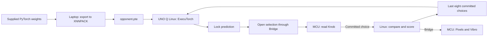

# QC UNO Q Workshop 301: Beat the Board

As part of this workshop, attendees will build a prediction game with the Arduino UNO Q and deploy its AI opponent using ExecuTorch.

The app interacts in the following manner:

- The MCU reads the Knob Modulino and drives the Pixels and Vibro Modulinos.
- The Linux MPU runs a pretrained model through ExecuTorch to predict the player's next left or right choice.
- The board locks its prediction before accepting a move. Fool it to win a point; get caught and the board scores instead.
- The Pixels reveal predictions and scores, while the Vibro signals when the board guesses correctly.
- Attendees export the supplied PyTorch model and deploy their own copy to the UNO Q.

All inference is local and does not depend on internet connectivity!

> [!IMPORTANT]
> This is a `301`-level workshop. Attendees should be comfortable with basic Python, running an App Lab project, and the MCU, MPU, and Bridge roles. No earlier workshop is required.
>
> Complete the software prerequisites before arriving. Downloading App Lab, board software, or Python dependencies during the session will cause delays and may prevent you from keeping up with the build.

## Session Prerequisites

1. Install [Arduino App Lab](https://www.arduino.cc/en/software/#app-lab-section) and provision the UNO Q.
2. Clone this repository using `git clone https://github.com/aaishikasb/uno-q-workshops.git` in your terminal.
3. Complete the [ExecuTorch Prework](#executorch-prework), including the laptop setup and readiness check.
4. If you have a UNO Q, follow the App Lab setup below and run the supplied app once while online to install its dependencies. The facilitator completes this preparation for boards provided on-site.

The workshop includes pretrained weights and an exported `.pte` model. Training is optional; the main exercise is exporting and deploying the supplied opponent.

## ExecuTorch Prework

Complete this section on your laptop before the session. You should be comfortable running Python scripts, importing modules, and working with lists and functions. Prior ExecuTorch experience is not required.

### What Is ExecuTorch?

ExecuTorch prepares PyTorch models for inference on devices. The workflow captures the model's operations, converts them into an executable program, and runs that program through the ExecuTorch runtime. Read [How ExecuTorch Works](https://docs.pytorch.org/executorch/1.5/intro-how-it-works.html) for the overview.

For this workshop, the path is:

```text
Laptop: model definition + trained weights -> export -> lower to XNNPACK -> opponent.pte
UNO Q Linux MPU: load opponent.pte -> supply eight choices -> predict left or right
UNO Q MCU: read the knob -> communicate through Bridge -> drive Pixels and Vibro
```

XNNPACK provides optimized CPU operations, including support for ARM64 Linux. This workshop uses the UNO Q's Linux CPU for inference. See the [XNNPACK backend documentation](https://docs.pytorch.org/executorch/stable/backends/xnnpack/xnnpack-overview.html).

### Concepts To Know

| Concept | Meaning in this workshop |
| --- | --- |
| Training and inference | Training adjusts model weights using examples. Inference uses fixed weights to predict the next choice. Gameplay performs inference. |
| Tensor, shape, and dtype | A tensor is an array of numbers. Our input is float32 with shape `[1, 8]`: one example containing eight choices. |
| Weights (`opponent.pt`) | Learned parameters loaded into the PyTorch model definition before export. |
| Export and lowering | Export captures the model's operations; lowering prepares them for execution through the chosen backend. Our export script performs both steps. |
| Program (`opponent.pte`) and runtime | The `.pte` is the exported artifact. The ExecuTorch runtime loads it and executes it for each input. |
| Logits | The two output scores, ordered `[left, right]`. The larger score selects the prediction; these are not confidence percentages. |
| Output parity | Checking that the exported model agrees with the original PyTorch model on the same inputs. |

### Prepare Your Laptop

Use Python 3.12 or 3.13 on macOS 14 or later (Apple Silicon), Linux, or Windows. From the repository root, create an environment and install the workshop's pinned dependencies:

```sh
python3 -m venv 301-beat-the-board/.venv
source 301-beat-the-board/.venv/bin/activate
python -m pip install --upgrade pip
python -m pip install -r 301-beat-the-board/training/requirements.txt
```

On Windows, use `py -3.13` instead of `python3` and activate with `301-beat-the-board\.venv\Scripts\Activate.ps1`. ExecuTorch's [setup guide](https://docs.pytorch.org/executorch/1.5/getting-started.html) specifies Visual Studio 2022 or later and a Visual Studio Developer PowerShell for Windows.

Use `training/requirements.txt` for the laptop. App Lab uses the separate `workshop-app/python/requirements.txt` for the UNO Q's ARM64 Linux environment. Keep the supplied versions so the exporter, runtime, and model metadata agree. Complete package downloads while online.

### Check Your Setup

With the laptop environment activated, run the supplied model without connecting hardware:

```sh
python -m pip check
python -B 301-beat-the-board/workshop-app/python/check_runtime.py
```

You are ready when the dependency check reports no broken requirements and the runtime check finishes without an exception, reporting `"backend": "XnnpackBackend"` and `"histories_checked": 256`. If it fails, use [Troubleshooting](#troubleshooting) before continuing.

Before the session, be able to explain why the model receives eight past choices, why the current move must stay hidden until the prediction is locked, and why changing the history does not retrain the model. Exporting a new `.pte` is part of the workshop itself.

### Knowledge Base

| Resource | Focus |
| --- | --- |
| [PyTorch tensor basics](https://docs.pytorch.org/tutorials/beginner/basics/tensorqs_tutorial.html) | Read the tensor creation and attributes sections if shapes or dtypes are new to you. |
| [How ExecuTorch Works](https://docs.pytorch.org/executorch/1.5/intro-how-it-works.html) | Understand the export, compilation, and runtime stages. |
| [Getting Started with ExecuTorch](https://docs.pytorch.org/executorch/1.5/getting-started.html) | Review model preparation and testing; use this workshop's requirements for installation. |
| [XNNPACK backend](https://docs.pytorch.org/executorch/stable/backends/xnnpack/xnnpack-overview.html) | See how a model is prepared for CPU execution. Quantization is optional further reading. |

## Hardware Setup (Provided On-site)

### Required Hardware

- Arduino UNO Q
- Modulino Knob
- Modulino Pixels
- Modulino Vibro
- 3 Qwiic cables
- USB-C cable

### Wiring

Chain the Modulinos with Qwiic:

```text
UNO Q Qwiic -> Modulino Knob -> Modulino Pixels -> Modulino Vibro
```

After connecting all Modulinos, connect the UNO Q to your computer with USB-C.

Pixels 0–3 represent the left side and player score. Pixels 4–7 represent the right side and board score. Orient the strip accordingly.

## App Lab Setup

1. Open Arduino App Lab.
2. Select your UNO Q board.
3. If the `Updates` modal appears, **DO NOT** update the board firmware during the workshop.
4. Open **My Apps**.
5. Import [workshop-app.zip](./workshop-app.zip) from this directory.
6. Open the imported `UNO Q Beat the Board` app.
7. Confirm these files are present:
   - `app.yaml`
   - `python/main.py`
   - `python/game.py`
   - `python/opponent.py`
   - `python/requirements.txt`
   - `python/models/opponent.pte`
   - `python/models/metadata.json`
   - `python/models/fixtures.json`
   - `sketch/sketch.ino`
   - `sketch/controls.h`
   - `sketch/sketch.yaml`
8. Click `Run` in the top-right corner.
9. Keep the App Lab output panel visible. It shows prompts, predictions, and exact scores.

App Lab compiles and flashes the MCU sketch, then starts the Python runtime on the UNO Q Linux side. Wait for `ExecuTorch opponent loaded: XNNPACK` and the first warm-up prompt.

Dependency installation happens on the Linux side using [python/requirements.txt](./workshop-app/python/requirements.txt). It pins ExecuTorch 1.5.1 and CPU-only PyTorch 2.14.0 for ARM64 Linux with Python 3.12 or 3.13. Gameplay uses neither the internet nor a laptop inference process after startup.

## How To Play

### Choose Your Move

- Turn left to select **left**, or right to select **right**. The corresponding half of the Pixels lights blue.
- Your most recent turn direction selects the side; rotation distance does not matter.
- Press the knob to commit. A press without a selection does nothing.
- Release before the next round. Turns and presses during feedback are ignored.

### Play A Match

Make **eight warm-up choices**. Amber Pixels fill to show the history growing; these moves do not score.

Then play **sixteen scored rounds**. Before each round opens, the board predicts from the last eight choices and keeps that guess hidden. After you commit:

| Feedback | Meaning |
| --- | --- |
| Pink lights on one half | The board's predicted side |
| Two pink flashes and a short vibration | It caught you: board gains a point |
| Green lights sweeping outward | You fooled it: player gains a point |
| Green on the left, pink on the right | Current score |

Each score Pixel represents four points, with partial brightness for one, two, or three. Check the output panel for the exact score.

After sixteen rounds, the higher score wins; 8–8 is a draw. The display alternates between score and winner: left green for you, right pink for the board, or both halves white for a draw. Release, then press to start a new match. Restarting the app also clears scores and history.

## Export Your Model

Activate the laptop environment prepared during [ExecuTorch Prework](#executorch-prework). From the repository root, export the supplied weights and verify the deployed artifact:

```sh
python -B 301-beat-the-board/training/export.py
python -B 301-beat-the-board/workshop-app/python/check_runtime.py
python -B 301-beat-the-board/package.py
```

The exporter checks that ExecuTorch and PyTorch predict the same side for all **256 possible eight-choice histories**. The runtime check confirms that the exported model loads and runs with XNNPACK.

Import the refreshed ZIP into App Lab and run it. Keep `opponent.pte`, `metadata.json`, and `fixtures.json` together when copying model assets. If laptop export setup gets in the way, continue with the supplied ZIP and return to the export exercise later.

## How The Demo Works



### MCU Responsibilities

- Read the knob position and debounce the button.
- Render selection, predictions, scores, and errors on the Pixels.
- Generate haptic feedback when the board guesses correctly.
- Send committed choices to Linux through Bridge.

### Linux MPU Responsibilities

- Keep the last eight choices and run ExecuTorch once per scored round.
- Lock each prediction before opening selection on the MCU.
- Compare the committed choice with the prediction and update the score.
- Pause gameplay if the model or Bridge reports an error.

## The Model

This workshop uses a small neural network trained on synthetic choice sequences. The input contains only the last eight committed choices; live knob position, pending selection, and button state are never given to the model.

| Property | Value |
| --- | --- |
| Network | `Linear(8, 32) → ReLU → Linear(32, 2)`; 354 parameters |
| Input | Float32 `[1, 8]`; left = -1, right = +1; oldest choice first |
| Output | Two logits ordered `[left, right]` |
| Decision | Largest logit; exact ties choose left |
| Deployment | ExecuTorch `.pte`, XNNPACK CPU backend on Linux MPU |

The eight warm-up moves avoid padding or invented history. The model scores are not presented as calibrated confidence.

### Retrain And Compare (Optional)

```sh
python -B 301-beat-the-board/training/train.py
python -B 301-beat-the-board/training/export.py
python -B 301-beat-the-board/workshop-app/python/check_runtime.py
python -B 301-beat-the-board/package.py
```

Training uses seeded synthetic sequences and next-choice cross-entropy. Training and evaluation use separate complete sequences before extracting overlapping windows. Triplets are reserved as an unfamiliar pattern. No player data is recorded.

Inspect [training/evaluation.json](./training/evaluation.json) to compare the neural model with “repeat the previous choice,” “choose the opposite,” and random guessing. Results are reported by pattern family; success on synthetic examples does not establish predictive skill against people.

## Suggested Experiments

1. Repeat one side throughout warm-up and the match.
2. Start a new match and alternate left/right.
3. Try pairs: left, left, right, right.
4. Switch strategy halfway through a match.
5. Try triplets or choose independently at random. Compare several matches.

The opponent has fixed weights; it does not train on you. Changing history changes the model input. It recognizes patterns from synthetic training sequences, and unfamiliar patterns can confuse it. Independent random choices should remain unpredictable; sixteen rounds alone do not establish a meaningful accuracy rate.

## Troubleshooting

### The app is installing packages

Let the first run finish while online. Prepare the board before the workshop; avoid firmware updates during the session.

### A dependency cannot be installed

Check the Python version in the error output and use the supplied requirements unchanged. Prepare an App Lab environment with Python 3.12 or 3.13 and sufficient disk space for PyTorch and ExecuTorch. The model is tiny, but the Python toolchain is much larger.

### The app reports a model error or version mismatch

Restore all three files in `workshop-app/python/models/` and use the pinned requirements. Re-export and package after changing the weights or exporter version.

### The button does nothing

Wait for the next round, release the button, turn to select a side, then press. Feedback screens do not accept moves.

### The Pixels flash red or the app reports GAME PAUSED

Check the Qwiic connections and App Lab output, then restart the app. Disconnect power before changing wiring. A failed read or Bridge call pauses play rather than inventing a move.

### The board is easy to beat

Compare against the repeating and alternating examples, then inspect the evaluation results. The model can miss unfamiliar patterns and cannot reliably predict independent random choices.

## Files

- [workshop-app/](./workshop-app/): self-contained App Lab source and model assets.
- [workshop-app/python/main.py](./workshop-app/python/main.py): runtime startup and game loop.
- [workshop-app/python/game.py](./workshop-app/python/game.py): match rules, scoring, and Bridge coordination.
- [workshop-app/python/opponent.py](./workshop-app/python/opponent.py): model loading and ExecuTorch inference.
- [workshop-app/sketch/sketch.ino](./workshop-app/sketch/sketch.ino): MCU input and physical feedback.
- [workshop-app.zip](./workshop-app.zip): import artifact.
- [training/](./training/): training/export scripts, supplied weights, and baseline results.
- [package.py](./package.py): builds the ZIP to import after exporting your model.

## Sources

- [UNO Q hardware](https://docs.arduino.cc/hardware/uno-q/)
- [Arduino App specification](https://github.com/arduino/arduino-app-cli/blob/main/docs/app-specification.md)
- [Arduino RouterBridge](https://github.com/arduino-libraries/Arduino_RouterBridge)
- [Modulino library](https://github.com/arduino-libraries/Arduino_Modulino)
